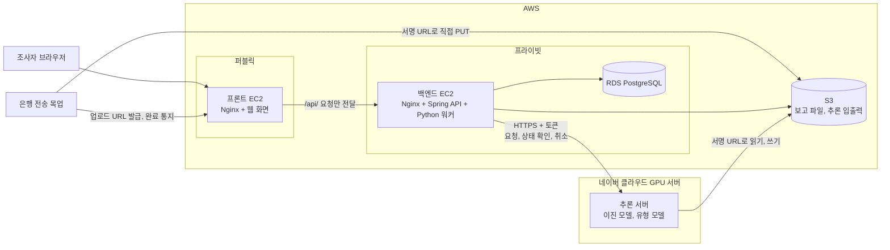

# 자금세탁 의심거래 모니터링 서비스

여러 은행이 보낸 거래 보고를 모아 그래프 모델로 의심 거래를 찾고, 조사자가 Alert 단위로 검토하는 감독기관형 모니터링 서비스입니다.

- 구분: 팀 프로젝트 (AI 개발자 양성 과정, 인공지능사관학교), 5인
- 기간: 2026.08 ~ 진행 중 (현재 통합 테스트와 배포 단계)
- 담당: 백엔드와 QA
- 이 저장소는 제가 맡은 부분을 정리한 공개용 정리본입니다. 팀 저장소는 비공개이며 요청 시 코드 열람이 가능합니다.

## 서비스 흐름

1. 은행이 업로드 URL을 발급받아 거래 보고 CSV를 S3에 올리고 완료를 알립니다.
2. 서버가 파일 크기와 SHA-256을 확인하고, 워커가 검수 후 은행별 보고로 저장합니다.
3. 매일 컷오프에 일별 분석 작업이 시작됩니다.

| 순서 | 단계 | 하는 일 | 실행 위치 |
|---|---|---|---|
| 1 | 적재 완료 대기 | 컷오프까지 받은 파일의 적재를 기다림 | Spring |
| 2 | 거래 통합 | 송신 은행과 수신 은행의 이중 보고를 통합 거래 한 건으로 확정 | Python 워커 |
| 3 | 분석 입력 고정 | 이번 실행이 읽을 거래 집합을 고정 (재시도해도 같은 입력) | Spring |
| 4 | 모델 입력 준비 | 모델과 무관한 재료 파일 작성 | Python 워커 |
| 5 | 모델 추론 | S3에 입력 게시, 추론 서버에 요청, 상태 확인 | Python 워커, 추론 서버 |
| 6 | 점수 저장 | 결과 검증 후 점수 저장 | Python 워커 |
| 7 | Alert 구성 | 의심 거래를 자금 흐름 단위로 묶어 Alert 계획 작성 | Python 워커 |
| 8 | Alert 공개 | 계획 검증 후 한 트랜잭션으로 공개 | Spring |

4. 조사자는 웹 화면에서 Alert를 검토하고 판정하거나 Episode로 이관합니다.

## 아키텍처

- 프론트 EC2만 외부에 열려 있고, 백엔드 EC2와 RDS는 내부에서만 접근합니다.
- Nginx가 `/api/`로 시작하는 요청만 백엔드로 넘기고 나머지는 웹 화면으로 보냅니다.
- 추론 서버는 DB에 접속하지 않습니다. 입력과 결과는 S3 서명 URL로만 주고받습니다.
- 추론 서버는 처음에 KubeSphere 파드에서 실행했고, 이후 네이버 클라우드 GPU 서버(T4)로 옮겼습니다. 백엔드는 배포 설정의 대상 값만 바꿔 연결 대상을 전환합니다.
- 접속 정보와 토큰은 저장소에 두지 않고 AWS Parameter Store에서 배포 시점에 읽습니다.

## API 구분

| 구분 | 경로 | 용도 |
|---|---|---|
| 은행 수집 | `/api/v1/bank/uploads`, `/api/v1/bank/corrections` | 업로드 URL 발급, 완료 통지, 정정 |
| 분석 작업 | `/api/v1/batch-jobs/...` | 일별 분석 상태 조회, 실패 작업 재개 |
| 조사 | `/api/v1/alerts`, `/api/v1/suspicious-transactions`, `/api/v1/review/...` | 의심 거래, Alert, Episode, 판정, 업무 요청 |
| 대시보드 | `/api/v1/dashboard/...` | 집계 조회 |
| 시연 제어 | `/api/v1/demo/...` | 업무 시계, 초기화 (개발 환경 전용) |
| 추론 | `/api/v1/inference-requests/{id}/rounds/{n}` | 추론 서버 쪽 API. 요청, 상태 확인, 취소 |

- 인증은 서버 세션 방식입니다.
- 목록은 공통 페이지 형식, 오류는 ProblemDetail과 오류 코드로 응답합니다.

## 기술

| 영역 | 사용 기술 |
|---|---|
| API 서버 | Java 21, Spring Boot 4, Spring Security, Flyway, springdoc |
| 워커, 추론 서버 | Python 3.13, psycopg, pyarrow, httpx, boto3 |
| DB | PostgreSQL 17 (역할별 스키마 분리, 분석 전용 계정) |
| 테스트 | JUnit, Testcontainers(PostgreSQL), unittest |
| 인프라 | AWS EC2, RDS, S3, ECR, Parameter Store, Nginx, Docker Compose, GitHub Actions |
| 프론트 (팀원 담당) | React, TypeScript, Vite |

## 내 역할

- API 서버: 은행 파일 수집, 일별 분석 작업 제어(단계 진행, 실행 소유권, 재시도, 재개), 조사와 대시보드 API, DB 스키마
- Python 워커: 파일 검수, 거래 통합, 모델 입력 준비, 추론 요청과 결과 수집, 점수 저장, Alert 구성
- 추론 서버의 서빙 부분: 요청 접수와 상태 저장, 취소, 모델 실행 프로세스 관리, 원장 사본 관리
- 모델 연결: 팀원이 만든 이진 모델과 유형 모델을 추론 서버 계약에 맞춰 연결
- 배포: 추론 서버 연결 대상 전환 설정, 개발 DB 재생성 도구, 개발 서버 처리 시간 측정과 개선
- 프론트: 화면이 쓰는 API 연결 (화면 설계와 UI는 팀원 담당)
- 통합 검증: 은행 전송 목업과 시연 제어 도구로 수집부터 Alert 공개까지 반복 실행

팀원 담당: 모델 설계와 학습, 프론트 화면, AWS 인프라 구성과 CI/CD.

## 설계에서 신경 쓴 점

- 같은 날짜 분석은 한 번만 실행됩니다. 실패하면 실패한 단계부터 이어서 실행합니다.
- 같은 단계가 같은 오류로 3회 연속 실패하면 자동 재시도를 멈추고 조치 필요로 표시합니다.
- 분석 입력을 실행마다 고정해, 재시도해도 같은 거래와 같은 값으로 계산합니다.
- 원문 계좌번호와 이름은 암호화해 별도 스키마에 두고, 분석 계정은 가명 식별값만 읽습니다.
- 모델을 바꿔도 백엔드와 추론 서버가 주고받는 형식은 그대로입니다. 모델 폴더와 등록표만 바꿉니다.
- 의심 판정 기준값은 모델 설정 한 곳에만 둡니다.

## 문제 해결 사례

- 추론 서버로 매일 전체 거래 이력을 보내던 방식을 바뀐 거래만 보내도록 바꿨습니다. 추론 서버가 원장 사본을 유지하고, 사본 위치가 맞지 않으면 전체를 다시 받습니다.
- 개발 DB에서 날짜가 쌓일수록 일별 분석이 느려졌습니다. 원인을 디스크 버스트 소진과 매일 전체 이력을 다시 읽는 쿼리로 좁히고, 읽는 범위를 줄이도록 쿼리를 고쳤습니다.
- 업로드 URL 발급 응답이 유실되면 재시도가 업로드를 건너뛰어 검증에 실패했습니다. 같은 파일의 재요청에는 같은 URL을 다시 내주도록 고쳤습니다.
- 계산 도중 추론 서버가 꺼지면 요청이 멈춘 채 남았습니다. 계산 프로세스의 잠금 해제를 확인한 뒤 실패로 바꿔, 백엔드가 다음 회차를 보낼 수 있게 했습니다.

## 아직 끝나지 않은 것

- 은행 인증은 목업 식별만 있고 실제 인증은 구현하지 않았습니다.
- 새로 바뀐 화면과 API의 연결은 통합 테스트 중입니다.
- 운영 환경의 분석은 시연 모드로만 동작합니다.

## 코드 발췌

[excerpts](excerpts) 폴더에 제가 작성한 코드 일부를 담았습니다. 설명은 [excerpts/README.md](excerpts/README.md)에 있습니다.

- 키, 접속 정보, 서버 주소, 데이터는 포함하지 않았습니다.
- 팀원이 작성한 모델과 화면 코드는 포함하지 않았습니다.
- 일부 파일만 옮겼기 때문에 이 저장소만으로는 실행되지 않습니다.
